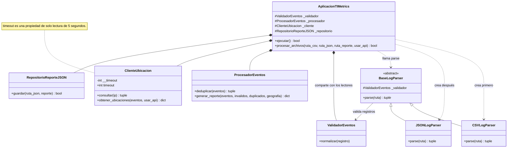

# Diagrama de clases de TI-Metrics

`python -m src.main` crea la aplicación y ejecuta el menú. La aplicación
llama a `parse(ruta)` primero con el lector CSV y luego con el lector JSON.
El método devuelve una lista de eventos válidos y la cantidad de registros
inválidos. `ValidadorEventos.normalizar` devuelve un diccionario o `None`.
